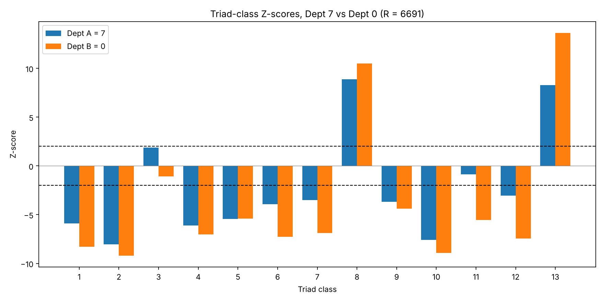

# Network Motifs in an Email Network: Benchmark Implementation

CS1005 Discrete Structures, Fall 2026. Reference solution for the course project (instructor use).

## What this does

Finds **network motifs**, the 3-node directed patterns (triads) that appear in a network far more or less often than chance predicts. It uses the SNAP `email-Eu-core` network and compares two departments' motif profiles.

For each department's internal email subgraph the pipeline:

1. Counts the 13 connected triad classes in the real graph.
2. Builds random graphs with the **same in- and out-degree for every node** (double-edge swaps) and counts the same 13 classes in each.
3. Computes `Z = (N_real - mean) / std` per class (population std; `Z = 0` if `std = 0`).
4. Flags class k as a **motif** if `Z > 2` and an **anti-motif** if `Z < -2`.

## Files

| File | Purpose |
|---|---|
| `motifs.py` | Complete implementation (T1-T7) |
| `requirements.txt` | Python dependencies (`pip install -r requirements.txt`) |
| `email-Eu-core.txt.gz` | SNAP edge list (downloaded automatically if missing) |
| `email-Eu-core-department-labels.txt.gz` | SNAP node-to-department labels (downloaded automatically if missing) |
| `zscores.png` | Output chart (T7), created on each run |

## Setup

Requirements:

- Python 3.9 or later
- `matplotlib` (chart)
- `networkx` (optional, only for the T4 cross-check; skip with `--no-verify`)

Both packages are listed in `requirements.txt`.

1. Put `motifs.py` and `requirements.txt` in one folder and open a terminal there.
2. Create and activate a virtual environment (recommended).

   Linux / macOS:
   ```
   python3 -m venv .venv
   source .venv/bin/activate
   ```
   Windows (PowerShell):
   ```
   python -m venv .venv
   .venv\Scripts\Activate.ps1
   ```
3. Install the dependencies:
   ```
   pip install -r requirements.txt
   ```
   On Arch Linux, or any system where pip refuses to install into the system Python, use the virtual environment above.
4. Get the data. The script downloads both SNAP files on first run. If your network blocks that, download them by hand from the SNAP `email-Eu-core` page and place them next to `motifs.py` with these exact names:
   - `email-Eu-core.txt.gz`
   - `email-Eu-core-department-labels.txt.gz`
5. Run it (see below). The first full run creates `zscores.png` in the same folder.

## Running

```
python motifs.py --digits 1234 4567 0890     # last-4-digit blocks of each roll number
python motifs.py --R 6691                    # or give R directly
python motifs.py --R 6691 --no-verify        # skip the networkx cross-check
```

For a quick smoke test (not for real results):

```
python motifs.py --R 6691 --networks 3 --attempts-factor 1
```

## Parameters (from R)

R is the sum of the last 4 digits of each group member's roll number.

| Quantity | Formula |
|---|---|
| Department pair | pair number `R mod 190` in the lexicographic list of pairs `(i, j)`, `0 <= i < j <= 19`, of the top-20 departments |
| Random networks | `20 + (R mod 31)` |
| Swap attempts per network | `(5 + (R mod 6)) x number_of_edges` |
| Random seed | `R` |

Worked example (R = 6691): pair number 41 = (2, 7), 46 random networks, 6 x edges swap attempts, seed 6691.

The top-20 departments are ranked by number of internal edges (descending, ties broken by smaller department ID).

## Method

**Cleaning (T1).** Self-loops and duplicate directed edges are removed. Raw 25,571 lines become 24,929 edges.

**Induced subgraph (T2).** Keep only edges whose two endpoints are both in the department.

**Triad class (T3).** The six possible directed edges among three nodes are encoded as a 6-bit number:

| bit | 0 | 1 | 2 | 3 | 4 | 5 |
|---|---|---|---|---|---|---|
| edge | 0->1 | 0->2 | 1->0 | 1->2 | 2->0 | 2->1 |

There are 64 labelled configurations. Trying all 6 orderings of the nodes and taking the minimum code gives a canonical code, which reduces the 64 to 16 isomorphism classes. Thirteen of these are connected and map to classes 1-13:

`{3:1, 6:2, 7:3, 10:4, 11:5, 15:6, 21:7, 23:8, 25:9, 27:10, 30:11, 31:12, 63:13}`

Hand example: edges 0->1 and 0->2 only give code `1 + 2 = 3`, which is already the minimum over orderings, so it is class 1.

**Census (T4).** There is no loop over all node triples. For each node `v`, every pair `{a, b}` of its neighbours (in or out) is added to a set as the sorted triple `(v, a, b)`. The set removes duplicates. Every triple in it is connected by construction. Each triple is then classified and tallied into 13 counts. On the full 24,929-edge graph this takes about 5 seconds.

**Randomization (T5).** One attempt picks two edges `(a, b)` and `(c, d)` from the current edge list and replaces them with `(a, d)` and `(c, b)`. The attempt is rejected, leaving the graph unchanged, if `a = d`, `c = b`, `(a, d)` is already an edge, or `(c, b)` is already an edge. Rejected attempts still count. Every random graph starts from the original graph, and one generator is seeded once with R.

Why degrees stay fixed: node `a` loses `a->b` and gains `a->d`, and node `c` loses `c->d` and gains `c->b`, so the out-degrees of `a` and `c` are unchanged. Node `b` loses an in-edge from `a` and gains one from `c`, and node `d` loses one from `c` and gains one from `a`, so the in-degrees of `b` and `d` are unchanged. The code asserts this for all nodes, plus that the graph stays simple (no self-loops, no duplicates, same edge count).

This matters because the Z-score then measures structure beyond degree. Hubs alone cannot create a motif.

**Z-scores (T6).** Population standard deviation (`statistics.pstdev`). If the standard deviation is 0, then `Z = 0`.

**Chart (T7).** Grouped bar chart: x axis is class 1-13, two bars per class (department A and B), dashed lines at +2 and -2, R in the title.

## Checking the implementation

- **Deterministic and exact:** the cleaned edge count, the top-20 list, all parameters, and the 13 real counts for each department. A student's real counts should match these exactly.
- **Not exactly reproducible:** the random counts and Z-scores depend on the random stream, so two correct implementations can differ in exact values even with the same seed. Compare signs and the motif or anti-motif flags, not exact numbers.
- **Cross-check:** `nx.triadic_census` can verify the real counts. Its class order differs from this assignment's, so classes must be mapped by structure. `motifs.py` does this mapping.

Checks run during development (not part of the repository):

- 64 labelled configurations give 16 orbits, of which 13 are connected, matching the handout table.
- Census equals a brute-force count over all node triples on small random graphs.
- Census equals `nx.triadic_census` on random graphs and on the full SNAP graph.
- Randomizer preserves degrees, is reproducible for a fixed seed, and changes the graph.
- The R = 6691 worked example reproduces the handout's parameters.

## Results (R = 6691)

Parameters: pair 41 = (2, 7), so Department A = 7 (51 nodes, 679 edges) and Department B = 0 (49 nodes, 426 edges). 46 random networks, 6 x edges swap attempts per network, seed 6691. Python 3.13.

| Class | Count A (dept 7) | Count B (dept 0) | Z (A) | Z (B) |
|---|---|---|---|---|
| 1 | 620 | 165 | -5.90 | -8.29 |
| 2 | 105 | 85 | -8.06 | -9.22 |
| 3 | 1525 | 741 | 1.87 | -1.06 |
| 4 | 46 | 77 | -6.11 | -7.02 |
| 5 | 96 | 21 | -5.43 | -5.39 |
| 6 | 452 | 69 | -3.94 | -7.29 |
| 7 | 249 | 209 | -3.51 | -6.89 |
| 8 | 689 | 806 | **8.89** | **10.49** |
| 9 | 0 | 1 | -3.68 | -4.40 |
| 10 | 108 | 26 | -7.57 | -8.92 |
| 11 | 110 | 19 | -0.87 | -5.55 |
| 12 | 890 | 244 | -3.06 | -7.45 |
| 13 | 809 | 342 | **8.29** | **13.64** |

Bold marks motifs (Z > 2). Every other class with Z < -2 is an anti-motif. The real counts are exact and match `nx.triadic_census`. The Z-scores depend on the random stream, so another correct implementation will give slightly different values with the same signs and flags.



**T8: how do the two departments communicate differently?** Both departments have the same overall shape: classes 8 and 13 are strong motifs and almost everything else is an anti-motif. Class 13 is the fully reciprocal triangle, where all three people write to each other. Class 8 is a person who exchanges mail both ways with two others who do not write to each other. So in both departments email is reciprocal and clustered far beyond what the degrees alone would produce, and one-way patterns such as chains, fan-outs and fan-ins are suppressed. The difference is in degree. Department 0 is more strongly reciprocal: its class 13 Z-score is 13.64 against 8.29, its class 8 Z-score is higher, and it rejects one-way and mixed patterns more strongly (for example classes 6, 7, 11 and 12). Department 7 is much denser, with 679 internal edges among 51 people and about 2.4 times as many full triangles (809 against 342), but its structure is closer to what its degrees would give: classes 3 and 11 are not significant, and classes 6, 7 and 12 are only mildly anti-motifs. In short, department 7 has more email, department 0 has more strictly reciprocal email.

## Notes

- The core tasks use only the Python standard library. `networkx` is used only to cross-check T4 and is never used for the census or the randomization.
- Do not copy this file as a submission. It is the instructor benchmark.
